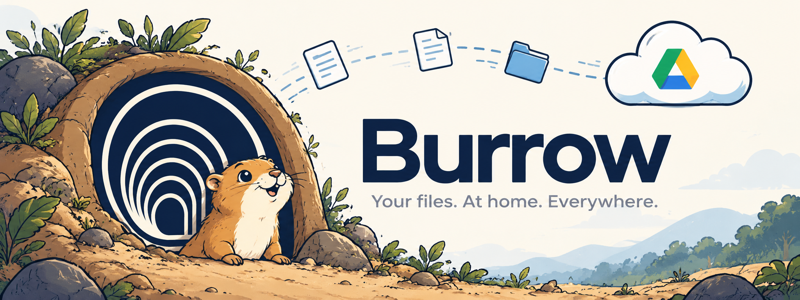

# Burrow



A Go daemon that watches one local folder and mirrors it to Google Drive. See `requirements.md` for scope and architecture.

## Install

Pick one. The binary must stay where you put it: the service remembers its path, and `syncd service install` refuses a binary in a temp folder.

- **Debian, Ubuntu (`.deb`):** download `burrow_<version>_linux_<arch>.deb` from the GitHub releases page, then `sudo apt install ./burrow_*.deb`. It puts `syncd` and `syncui` in `/usr/bin`, adds a **Burrow** entry to the app menu (search for "Burrow" to start the tray right away), and starts the tray for every user at their next login.
- **Other Linux, Windows:** unpack the release archive and move `syncd` (and `syncui`, kept next to it) somewhere permanent, such as `~/.local/bin`.
- **macOS:** unpack the archive (`syncd` only) and move it somewhere permanent. Run `xattr -d com.apple.quarantine syncd` once, since the binary is not code-signed.
- **From source:** do "Google Cloud setup" and "Local configuration" below, then `make build` (and `make build-ui` for the tray). Keep `bin/syncd` where it is.

Check it with `syncd version`. Then sign in and start the service as below. More on releases under "Install from a release".

## Quick start

1. **Get `syncd`.**
   - On a `.deb` system: `sudo dpkg -i burrow_*.deb` (see "Install from a release"), then go to step 2.
   - From a release: unpack the archive for your system (see "Install from a release" below) and move `syncd` to a place it will stay, such as `~/.local/bin`. The service remembers the path it was installed from, so do not move or delete the binary afterwards.
   - From source: do the "Google Cloud setup" and "Local configuration" below, then `make build`. The binary is `bin/syncd`; keep it where it is.
2. **Start the tray and sign in.** On a `.deb` install, search for "Burrow" in your app menu (or log out and in; otherwise run `syncui &`), click **Sign in…** in the tray menu, and finish in the browser. Without the tray: `syncd login`.
3. **That is all.** Signing in installs and starts the background service for `~/MySync` and, on a machine that has not synced before, downloads what is already in your Drive folder into it (the tray shows `Downloading 12 of 340…`). To use another folder run `syncd service install --root ~/Sync`; to sign in without installing the service, `syncd login --no-service`. From source, run these from the folder that holds your `.env`.
4. **Check it:** `syncd service status` and `syncd ctl status` (state, queue, last sync). Put a file in the sync folder and it appears in Drive within about a minute. Failures show up in `syncd errors`.
5. **Linux only, to start before you log in:** `loginctl enable-linger $USER`. Without it the service starts when you log in, not when the machine boots.
6. **Tray icon:** the tray registers itself to start at every login the first time it runs (on Linux `~/.config/autostart/burrow-syncui.desktop`; on macOS a launch agent; on Windows a Run-key entry), and `syncd login` and `syncd service install` register it too when a `syncui` binary sits next to `syncd`. Starting it twice leaves one icon. `syncd` syncs with or without it, and quitting the tray does not stop syncing. **No icon on GNOME?** Stock GNOME hides tray icons: install the AppIndicator extension (`sudo apt install gnome-shell-extension-appindicator`, then enable it in the Extensions app and log out and in; Ubuntu ships it enabled). To stop the tray starting at login, put `Hidden=true` in `~/.config/autostart/burrow-syncui.desktop`.

If nothing syncs after a restart: `syncd service status` (Linux: `systemctl --user status syncd.service`, logs with `journalctl --user -u syncd.service -b`). A "not signed in" or "session expired" message means run `syncd login` again.

## Uninstall

```
syncd uninstall            # remove the login registrations and quit the tray
syncd uninstall --purge    # also sign out and delete the app data dir
```

`uninstall` removes the background service, the tray's autostart entry and a running tray. `--purge` also deletes the saved token from the keychain and the app data dir (`~/.local/share/burrow/` on Linux: database, logs, `state.json`). Neither touches your sync folder or anything in Drive, and the token is not revoked at Google (remove Burrow at <https://myaccount.google.com/permissions> for that). Run it as each user who ran `syncd service install`, **before** removing the program, since it needs the binary.

Then remove the program:

- **`.deb`:** `sudo apt remove burrow`. The package script only prints a reminder, because root cannot reach your login items or keychain.
- **Archive or source:** delete `syncd` and `syncui`.
- **Leftovers to check:** `~/.config/systemd/user/syncd.service`, `~/.config/autostart/burrow-syncui.desktop` (Linux), `~/Library/LaunchAgents/dev.burrow.*` (macOS). `syncd uninstall` removes these.

## Google Cloud setup

Burrow signs in as your own Google account with an OAuth desktop client. You create that client once, in your own Google Cloud project.

1. **Create a project.** Open <https://console.cloud.google.com/projectcreate>, name it `burrow` and create it. Make sure it is selected in the top bar.
2. **Enable the Drive API.** Open <https://console.cloud.google.com/apis/library/drive.googleapis.com> and click **Enable**.
3. **Configure the consent screen.** Open <https://console.cloud.google.com/auth/overview> and click **Get started**.
   - App name `Burrow`, plus your support email.
   - Audience: **External**.
   - Contact information: your email.
4. **Add the scope.** Under **Data Access**, add only `https://www.googleapis.com/auth/drive.file`. Burrow can then see only the files it creates, and Google does not need to verify the app.
5. **Publish the app.** Under **Audience**, click **Publish app** so the status reads **In production**. In "Testing" mode refresh tokens expire after 7 days, which looks like random sign-in failures.
6. **Create the OAuth client.** Open <https://console.cloud.google.com/auth/clients>, click **Create client**, choose **Desktop app** and name it `burrow-desktop`. Copy the client ID and client secret.

An "unverified app" warning at sign-in is normal for `drive.file`.

## Install from a release

Download the archive for your OS and CPU from the GitHub releases page (`burrow_<version>_<os>_<arch>`; `.zip` on Windows, `.tar.gz` elsewhere), check it against `checksums.txt` (`sha256sum -c --ignore-missing checksums.txt`), and unpack it. The Linux and Windows archives hold `syncd` and the tray app `syncui`; the macOS archives hold `syncd` only (the tray needs cgo, so build it on a Mac with `make build-ui`).

**Debian, Ubuntu and other `.deb` systems:** download `burrow_<version>_linux_<arch>.deb` and run `sudo dpkg -i burrow_*.deb` (or `sudo apt install ./burrow_*.deb`). It installs `syncd` and `syncui` into `/usr/bin` and adds `/etc/xdg/autostart/burrow-syncui.desktop`, so the tray icon starts for every user at their next login (log out and in, or run `syncui &` now); then follow the Quick start from step 2 (`syncd login`, `syncd service install`). Remove it as described under "Uninstall". The tray starts with the package either way; to stop it, remove the package or put `Hidden=true` in a copy of the file at `~/.config/autostart/burrow-syncui.desktop`.

A release binary has the OAuth client built in, so it needs no `.env`: run `syncd login`, then `syncd run` (or `syncd service install`). Binaries are not code-signed, so macOS Gatekeeper (`xattr -d com.apple.quarantine syncd`) and Windows SmartScreen warn on first run.

To cut a release (maintainers): `git tag vX.Y.Z`, then `make release` (needs `goreleaser` and a signed-in `gh`; it loads the client from `.env` and refuses on a dirty tree or an untagged HEAD). `make release-check` builds the same archives locally into `dist/` without publishing.

## Local configuration

Copy the example file and fill in the two values from step 6:

```
cp .env.example .env
```

```
BURROW_GOOGLE_CLIENT_ID=<client ID>
BURROW_GOOGLE_CLIENT_SECRET=<client secret>
```

`.env` is git-ignored. Never commit it. Variables already set in your shell take precedence over `.env`.

The client ID must never change once files have been uploaded. `drive.file` access is tied to the client ID, so a different client cannot see files created by the first one.

## Sign in

```
make build
bin/syncd login
```

Your browser opens to Google's consent screen (scope `drive.file` only). When you approve, the terminal prints `Signed in as <email>`, and the refresh token is saved in your OS keychain (never in a file or the database).

```
bin/syncd whoami   # signs in silently from the saved token and prints the email
bin/syncd logout   # clears the saved token (does not revoke it at Google)
```

On Linux the keychain is the Secret Service (GNOME Keyring or KWallet), so a desktop session is needed. Without one, `login` and `whoami` fail with a keychain error rather than storing the token elsewhere.

## Drive root folder

```
bin/syncd root   # finds or creates MySync/ in My Drive, prints its ID and URL
```

Burrow creates and owns `MySync/` itself. With the `drive.file` scope it cannot see a folder you made by hand, so a hand-made `MySync/` is ignored. Running `root` again prints the same ID and creates nothing.

The folder ID is cached in `state.json` in the app data dir (`~/.local/share/burrow/` on Linux). The cache is disposable: delete it and the next run finds the existing folder again. If you trash `MySync/` in the web UI, the next run notices and creates a new one.

## Uploading a file

```
bin/syncd put [--root DIR] <file>                # uploads into MySync/ (nested folders mirrored), prints the file ID and link
bin/syncd stat <file-id>                         # prints ID, name, size, MD5, revision and tags
bin/syncd stat --path <rel_path>                 # same, found by its rel_path tag instead of ID
bin/syncd stat --local [--path] <id or rel_path>  # only what the state database knows, incl. the inode; no sign-in
```

Every upload is tagged in Drive with its `rel_path`. Without `--root`, `rel_path` is the file's name; with it, the path relative to `--root` (a file outside the root is rejected). Putting a file with the same `rel_path` again updates the existing Drive file instead of making a second one. A file with `rel_path` `a/b/c.txt` is uploaded into `MySync/a/b/`; missing folders are created on the way, and existing ones are reused, never duplicated. To mirror a whole tree for now:

```
find tree -type f -exec bin/syncd put --root tree {} \;
```

Files are streamed in 8 MB chunks, so uploading a multi-gigabyte file does not use more memory than a small one. If a run is killed mid-upload, the file simply uploads again on the next run. Throttling and server errors (429, 5xx, rate-limit 403s) and network blips are retried up to 5 times with exponential backoff and jitter; other errors, such as permission or quota, fail the file at once.

Folder IDs are cached in the state database (see below) so later files in the same folder cost no lookups. The cache is disposable: delete `burrow.db` and the next `put` finds the existing folders again. `stat --path` only reads; it creates nothing in Drive.

## Scanning

```
bin/syncd scan --dry-run [--root DIR]   # lists the files a sync would upload; changes nothing
```

`--dry-run` is required. The root defaults to `~/MySync`. Output is one slash-form path per line on stdout (so it pipes cleanly); skipped entries and a `N files, M ignored` summary go to stderr. Symlinks and other special files are skipped, and an unreadable file or folder is reported and skipped without stopping the scan. A missing root, or a file given as the root, exits 1.

Ignored by default: `.git`, `node_modules`, `*.tmp` and `~$*` (editor temp files). To add your own rules, put a `.syncignore` file in the root, in gitignore syntax (`*.log`, `build/`, `**/gen/*.go`, `!keep.log`). A rule can re-include a default such as `*.tmp`, but never `.git`, and `.syncignore` itself is never listed.

## Syncing a folder

```
bin/syncd sync [--root DIR]   # uploads new files and updates changed ones
```

The root defaults to `~/MySync`. Each file is uploaded into the Drive folder that mirrors its path, in `rel_path` order, and `sync` prints `uploaded <rel_path>` or `updated <rel_path>` for each one. The same ignore rules as `scan` apply (see above), so run `scan --dry-run` first to see what would go. Work is queued in the state database and uploaded by `--workers N` files at a time (1 to 16, default 3). If a run is killed, the next `syncd sync` prints `resuming N queued jobs` and carries on. Run `bin/syncd errors` to see what is failing and why (for example `docs/a.pdf  Drive storage quota exceeded, will retry`); it needs no sign-in, and a file leaves the list once it syncs. Failed files are listed on stderr with a summary (`N uploaded, M updated, X moved, T trashed, K already synced, J failed, I ignored`), and the exit code is 1 if any failed.

Every uploaded file gets a row in the state database (see below). A file whose size and mtime match its row is skipped without being read; otherwise it is hashed (MD5) and skipped if Drive already has that content, or replaced in place (same Drive file ID) if not. So a second run uploads nothing, touching a file uploads nothing, editing one file updates only that file, and an interrupted run (Ctrl+C) continues where it stopped. The database is disposable: delete `burrow.db` and the next run finds each file in Drive by its path and updates it in place, without duplicates. `sync` needs the database, so it stops with an error if it cannot open.


## Shared settings

`syncd config show` prints `config.json`, a small settings file kept in `MySync/` in Drive. `syncd config ignore add '*.log'` (or `rm`) edits its ignore rules; every `syncd sync` or `syncd run`, on any machine, reads them at start, after the built-in defaults and before the root's `.syncignore` (which can still override them). If the file cannot be read, `sync` and `run` stop instead of uploading what it may exclude.

## Remote listing

`syncd remote ls` prints every file under `MySync/` in Drive: `rel_path`, size, MD5 and Drive file ID, one per line, sorted by path (the count goes to stderr). It needs sign-in and does not touch the local folder or database.

`syncd remote get <rel_path> [<local path>]` downloads one file. It is written to a temporary `.tmp` file next to the target, checked against Drive's MD5 and then renamed into place, so you never see a partial file; on a mismatch nothing is written. An existing target is replaced.

## Drive changes

`syncd changes` prints what changed on Drive since you last asked, from the Drive changes feed: `modified <rel_path>`, `trashed <rel_path>` or `removed <file id>`, one per line. The first run only records "now" (`watching Drive changes from now`); edit a file in the Drive web UI and run it again to see it. The position is saved in the state database after the lines are printed, so a failed run repeats them. `syncd`'s own uploads are hidden; `--all` shows them, `--reset` starts again from now. If Drive no longer accepts the saved position it says so and starts again from now (run `syncd sync` or `restore` to catch up). It takes the database lock, so stop `syncd run` first. It only reports; nothing is downloaded yet.

## Restoring on a new machine

`syncd restore [--root DIR]` fills the sync root (default `~/MySync`) from Drive and records every file in the state database. A file that is missing is downloaded (verified, then renamed into place); one that is already there with the same content is only recorded; one with different content is kept as `name (conflicted copy, <host>, <date>).ext` and Drive's version is downloaded to the original path, so both survive. Run it again if some files failed, then `syncd run` to keep syncing. You usually do not need to run it by hand: the first `syncd run` on a machine whose database has never synced (a new install, or after `syncd uninstall --purge`) does the same restore by itself before it starts watching, and shows it as `Downloading N of M…` in the tray. Files that fail appear in `syncd errors`; run `syncd restore` to try them again. Use a machine as restore-only, or give it its own root, until two-way sync exists.

## Running live

```
bin/syncd run [--root DIR] [--workers N] [--settle 1s]   # Ctrl+C to stop
```

`run` watches the sync root and uploads each file a couple of seconds after you stop changing it: the foreground version of the daemon. It prints `uploaded <path>` / `updated <path>` / `failed <path>: ...` lines like `sync`, finishes jobs left over from an earlier run first, tries failed uploads again every 5 minutes, and on Ctrl+C leaves unfinished uploads queued. At start it compares the root with the state database and queues files that are new or changed since the last run, so edits made while it was stopped are uploaded (`syncd scan --dry-run --diff` previews that list; files gone locally are trashed in Drive). A renamed or moved file is moved in Drive, keeping its Drive file ID and history, instead of being uploaded again (`moved old -> new`; a rename combined with an edit still uploads the file as new). A renamed folder is moved in Drive as one folder, children intact, and a deleted folder is trashed once its files are. A file deleted locally is moved to the Drive trash (`trashed <path>`), never deleted for good, so you can restore it from the Drive web UI. Only one of `run` and `sync` can run at a time (the second refuses to start). A panic in the daemon is logged and the daemon keeps going; on Linux a very large tree may need `fs.inotify.max_user_watches` raised, and `syncd` prints the command when it hits the limit.

While `syncd run` is going, `syncd ctl status` (from another terminal) prints its state, the queue length and the time of the last finished job; `syncd ctl pause` stops new uploads (the queue keeps filling) and `syncd ctl resume` continues. It talks to `syncd.sock` in the data directory, readable only by you.

## Tray icon

`make build-ui` builds `bin/syncui`, a tray icon for a running `syncd run`: green while syncing, amber when paused, gray when `syncd` is not running. Its menu shows the queue length and the last sync and has a Pause/Resume item (the same as `syncd ctl pause|resume`). Quitting the tray does not stop syncing. On Windows build it with `-ldflags "-H=windowsgui"`; on macOS it needs cgo.

## Starting at login

`syncd service install [--root DIR]` (run it from the folder with your `.env`) registers `syncd run` with the OS and starts it: a systemd user unit on Linux, a launch agent on macOS, a Run-key entry on Windows. It starts when you log in and is restarted after a failure. `syncd service status` shows whether it is installed and active, `syncd service uninstall` removes it (`syncd uninstall` also quits the tray and can purge your data). On Linux, `loginctl enable-linger $USER` starts it at boot even before you log in. If a `syncui` binary sits next to `syncd`, install also registers the tray icon to start with your desktop session (`syncd service uninstall` removes both). macOS release archives have no `syncui`. Use `syncd ctl status` to see what it is doing.

## Watching (preview)

```
bin/syncd watch [--root DIR] [--settle 1s] [--raw]
```

`watch` prints `ready <path>` once a file has stopped changing: it waits until the file has been quiet for `--settle` and its size and mtime match across two checks, so one editor save is one line and a big copy is one line after it finishes. `--raw` prints every create, write, rename and remove event instead. New folders are picked up too, and ignored paths are skipped as in `scan`. It uploads nothing yet; live sync arrives with the next tickets.

## Revision history

```
bin/syncd history <rel_path>   # revisions recorded for a file, newest first
```

Every upload or update records the Drive revision in the state database. `history` prints one line per revision: time (UTC), revision ID, MD5, size and source. It needs no sign-in. Files uploaded before this feature have no history until their next upload.

## State database

```
bin/syncd db path     # prints where the database lives; creates nothing
bin/syncd db status   # opens and migrates it, then prints path, migration version and tables
```

The database is a local SQLite cache at `burrow.db` in the app data dir (`~/.local/share/burrow/` on Linux), next to `state.json`. Drive is the source of truth, so the file is disposable: delete it and the next `db status` recreates it. It is never synced and never inside the sync root.

## Logging

```
SYNC_LOG=debug bin/syncd sync --root tree   # log lines on stderr at that level
bin/syncd sync --root tree                  # info lines go to the log file instead
```

`SYNC_LOG` takes `debug`, `info`, `warn` or `error`; any other value exits 2. Without it, `info` and above are written to `~/.local/share/burrow/logs/syncd.log` (10 MB files, 10 backups) and stderr only shows command output. Lines carry `path`, `job` and `drive_file_id`. Tokens, auth headers and file contents are never logged.

## Development

```
make build   # builds bin/syncd
make vet     # go vet ./... (also for GOOS=windows and darwin)
make test    # go test -race ./...
make release-check  # snapshot release archives in dist/ (needs goreleaser and .env)
```
